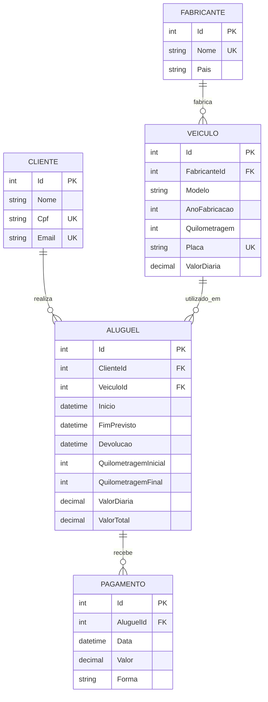

# Modelo conceitual e relacional

**Fabricante** identifica a marca. Um fabricante possui vários veículos; cada veículo pertence a exatamente um fabricante. **Cliente** realiza vários aluguéis. Cada aluguel refere-se a um cliente e um veículo. Cada aluguel pode ter vários pagamentos.

O EF Core traduz essas classes em cinco tabelas do SQL Server Express. `Id` é a chave primária inteira com geração pelo banco. `FabricanteId`, `ClienteId`, `VeiculoId` e `AluguelId` são chaves estrangeiras obrigatórias. Exclusão em cascata está desativada para preservar histórico.

Restrições: placa, CPF, e-mail e fabricante únicos; ano entre 1900 e 2100; quilômetros não negativos; diária e pagamento positivos; fim previsto após início; devolução, quilometragem final e total preenchidos juntos. `decimal(12,2)` evita erros monetários de ponto flutuante. Índice composto em veículo e período favorece a busca de conflitos de agenda.

**Regra temporal:** o veículo não pode ter aluguéis sobrepostos. Enquanto um aluguel não for devolvido, ele bloqueia outro que se sobreponha ao seu início, mesmo que o fim previsto já tenha passado. A verificação ocorre em transação com isolamento `SERIALIZABLE`. A devolução grava a data, quilometragem final e total, e atualiza a quilometragem corrente do veículo.
