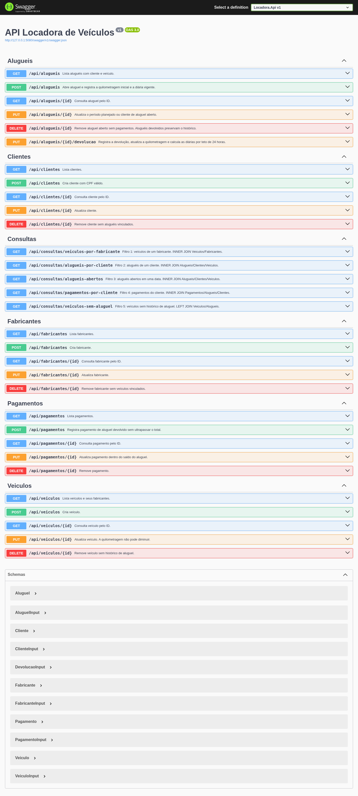

# Relatório de testes manuais no Swagger

**Estado da evidência:** preencha esta seção durante a execução em SQL Server Express. O projeto foi preparado com Swagger em `/swagger`; respostas e capturas de chamadas ainda dependem de executar o servidor com um banco acessível. Não atribua "aprovado" sem executar o caso e salvar sua captura.

## Preparação

1. Aplique a migração com `dotnet tool run dotnet-ef database update --project Locadora.Api`.
2. Inicie a API com `dotnet run --project Locadora.Api --urls http://localhost:5080`.
3. Abra `http://localhost:5080/swagger` e use **Try it out** em cada rota.
4. Salve uma captura com **método, rota, corpo/parâmetros, status e resposta** por caso em `docs/evidencias/`, usando nomes como `01-post-fabricantes.png`.
5. Anote o ID devolvido por cada POST para usar nos testes seguintes. Use dados fictícios. Para DELETE, crie objetos extras sem histórico.

## Matriz de casos

| Nº | Chamada no Swagger | Entrada | Retorno esperado | Status real | Captura |
|---|---|---|---|---|---|
| 01 | POST `/api/fabricantes` | `{"nome":"Renault","pais":"Franca"}` | 201 e ID | Pendente | Pendente |
| 02 | GET `/api/fabricantes` | — | 200 lista | Pendente | Pendente |
| 03 | GET `/api/fabricantes/{id}` | ID de 01 | 200 objeto | Pendente | Pendente |
| 04 | PUT `/api/fabricantes/{id}` | `{"nome":"Renault Brasil","pais":"Brasil"}` | 204 | Pendente | Pendente |
| 05 | DELETE `/api/fabricantes/{id}` | fabricante extra sem veículos | 204 | Pendente | Pendente |
| 06 | POST `/api/clientes` | `{"nome":"Ana Exemplo","cpf":"52998224725","email":"ana@test.local"}` | 201 e ID | Pendente | Pendente |
| 07 | GET `/api/clientes` | — | 200 lista | Pendente | Pendente |
| 08 | GET `/api/clientes/{id}` | ID de 06 | 200 objeto | Pendente | Pendente |
| 09 | PUT `/api/clientes/{id}` | mesmo CPF, nome ou e-mail alterado | 204 | Pendente | Pendente |
| 10 | DELETE `/api/clientes/{id}` | cliente extra sem aluguel | 204 | Pendente | Pendente |
| 11 | POST `/api/veiculos` | `{"fabricanteId":<ID de 01>,"modelo":"Polo","anoFabricacao":2022,"quilometragem":25000,"placa":"ABC1D23","valorDiaria":150}` | 201 e ID | Pendente | Pendente |
| 12 | GET `/api/veiculos` | — | 200 lista | Pendente | Pendente |
| 13 | GET `/api/veiculos/{id}` | ID de 11 | 200 objeto | Pendente | Pendente |
| 14 | PUT `/api/veiculos/{id}` | mesmos campos, diária 160 | 204 | Pendente | Pendente |
| 15 | DELETE `/api/veiculos/{id}` | veículo extra sem aluguel | 204 | Pendente | Pendente |
| 16 | POST `/api/alugueis` | cliente e veículo criados; período futuro | 201 e ID | Pendente | Pendente |
| 17 | GET `/api/alugueis` | — | 200 lista | Pendente | Pendente |
| 18 | GET `/api/alugueis/{id}` | ID de 16 | 200 objeto | Pendente | Pendente |
| 19 | PUT `/api/alugueis/{id}` | mesmo veículo; fim previsto ampliado | 204 | Pendente | Pendente |
| 20 | PUT `/api/alugueis/{id}/devolucao` | data após início; km >= km inicial | 200, total calculado | Pendente | Pendente |
| 21 | DELETE `/api/alugueis/{id}` | aluguel extra aberto, sem pagamentos | 204 | Pendente | Pendente |
| 22 | POST `/api/pagamentos` | aluguel de 20, valor <= total | 201 e ID | Pendente | Pendente |
| 23 | GET `/api/pagamentos` | — | 200 lista | Pendente | Pendente |
| 24 | GET `/api/pagamentos/{id}` | ID de 22 | 200 objeto | Pendente | Pendente |
| 25 | PUT `/api/pagamentos/{id}` | mesmo aluguel, valor válido | 204 | Pendente | Pendente |
| 26 | DELETE `/api/pagamentos/{id}` | ID de 22 | 204 | Pendente | Pendente |
| 27 | GET `/api/consultas/veiculos-por-fabricante` | ID de 01 | 200 lista | Pendente | Pendente |
| 28 | GET `/api/consultas/alugueis-por-cliente` | ID de 06 | 200 lista | Pendente | Pendente |
| 29 | GET `/api/consultas/alugueis-abertos` | `em` durante aluguel aberto | 200 lista | Pendente | Pendente |
| 30 | GET `/api/consultas/pagamentos-por-cliente` | ID de 06 | 200 lista | Pendente | Pendente |
| 31 | GET `/api/consultas/veiculos-sem-aluguel` | `fabricanteId` opcional | 200 lista | Pendente | Pendente |
| 32 | POST `/api/clientes` | CPF inválido | 400 | Pendente | Pendente |
| 33 | POST `/api/alugueis` | período conflitante | 409 | Pendente | Pendente |
| 34 | POST `/api/pagamentos` | valor acima do total | 409 | Pendente | Pendente |
| 35 | GET `/api/veiculos/999999` | ID inexistente | 404 | Pendente | Pendente |

Ao concluir, substitua "Pendente" pelo status recebido e pelo nome da captura correspondente. O relatório deve conter a resposta real obtida, especialmente para erros e para o total calculado. Para cada caso, cole o JSON retornado abaixo da matriz ou em um anexo numerado.

## Verificação efetuada neste ambiente

- `dotnet build`: aprovado, 0 avisos e 0 erros.
- Migração EF Core `InitialCreate`: gerada.
- `GET /swagger/v1/swagger.json`: HTTP 200; 31 operações distribuídas em 16 caminhos.
- Tela do Swagger: carregou as 31 operações. Captura: `swagger-visao-geral.png`.
- Chamadas CRUD no SQL Server Express: pendentes. A imagem do SQL Server Express não pôde ser instalada neste ambiente por falta de espaço em disco. Portanto, as colunas de status real e captura acima não foram preenchidas com resultados inventados.

